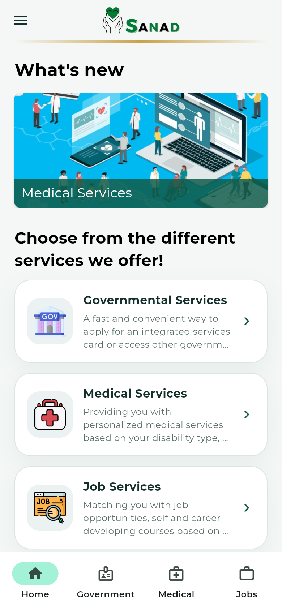
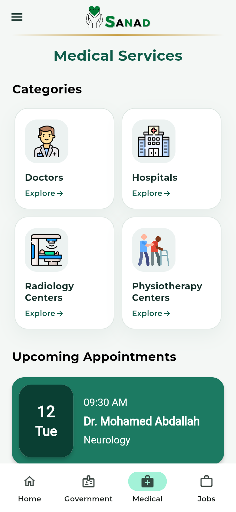
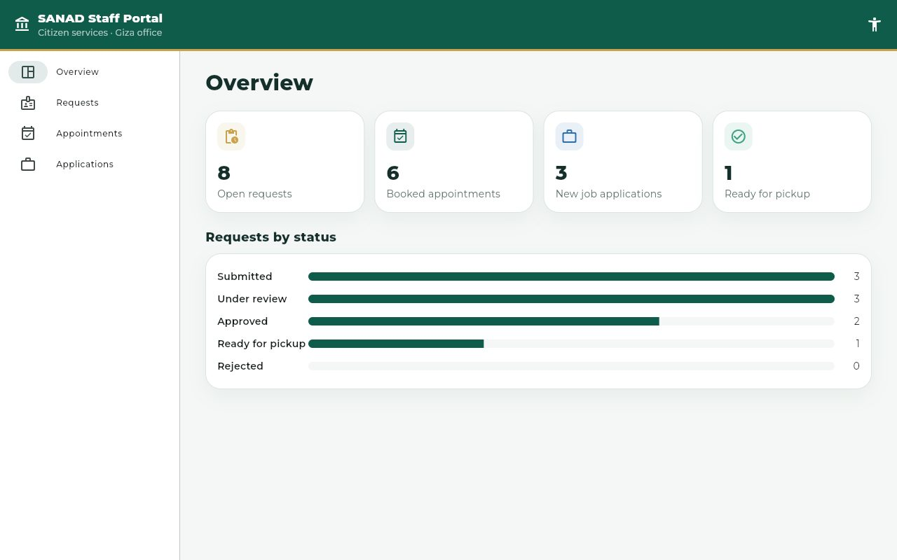

# SANAD

*More than a helping hand.* SANAD is my graduation project: one Flutter app for everyday public services in Egypt, designed for people with disabilities, with a staff portal behind it.

**Try it in the browser:** [eyadoraby.github.io/grad](https://eyadoraby.github.io/grad/) · [with demo activity](https://eyadoraby.github.io/grad/?demo=1&screen=activity) · [staff portal](https://eyadoraby.github.io/grad/?demo=1&screen=staff)

| Home | Medical services | Staff portal |
|---|---|---|
|  |  |  |

## For citizens

- **Government services**: renew a national ID or apply for an integrated services card; every request gets a reference number and a status (submitted, under review, approved, ready for pickup)
- **Medical services**: find doctors, hospitals, radiology and physiotherapy centers and book a day and time; taken slots are blocked, and bookings can be cancelled
- **Jobs**: apply once per job and follow the application (applied, shortlisted, interview)
- **Activity**: appointments, requests and applications in one place
- **Accessibility**: text size up to 160%, high contrast, bold text and reduced motion, applied everywhere and saved; screen-reader labels on progress, statuses and controls

## For staff

The **staff portal** (drawer → Staff portal, or `?screen=staff`) is a dashboard on the web and tabs on phones:
- Overview: open requests, booked appointments, new applications and requests by status
- Requests queue: start review, approve, mark ready for pickup or reject
- Appointments table with "mark attended", and job applications to shortlist, invite or decline

## Running it

```bash
flutter pub get
flutter run            # a device or emulator
flutter run -d chrome  # the web version
```

On the web, `?screen=` opens a section directly, for example `?screen=medical`, `?screen=doctors` or `?screen=jobs`. The full list is in [`lib/deep_links.dart`](lib/deep_links.dart).

## Tests and CI

- `flutter test`: store logic plus smoke tests that render every screen in English and Arabic at phone (390 px) and desktop (1280 px) widths, failing on any layout overflow. 85 tests, 75% line coverage.
- `flutter analyze` reports no errors or warnings.
- CI runs analyze, tests and a web build on every pull request, then deploys the web demo and builds the Android app from `main`.

## Notes

- Data is saved on the device through a small `SanadStorage` interface (SharedPreferences in the app, memory in tests), seeded with sample requests from other citizens so the staff portal has work in it. Firebase is configured for a future Cloud Firestore backend.
- Sign-in accepts any national ID while there is no accounts backend.
- Updated in 2026 to current Flutter and Dart 3: replaced discontinued packages, Material 3 navigation, fixed sign-out and the app's start flow. CI runs analyze, tests and a web build on every pull request.
